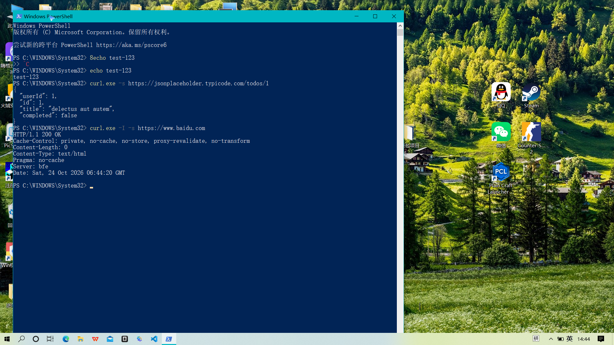

## 二、操作过程（Windows PowerShell 中运行）

### 1. GET 请求：获取 API 返回的 JSON 数据

运行命令：

```bash
curl.exe -s https://jsonplaceholder.typicode.com/todos/1
```

输出结果：

```json
{
  "userId": 1,
  "id": 1,
  "title": "delectus aut autem",
  "completed": false
}
```

### 2. HEAD 请求：查看百度网页的响应头

运行命令：

```bash
curl.exe -I -s https://www.baidu.com
```

输出结果：

```
HTTP/1.1 200 OK
Cache-Control: private, no-cache, no-store, proxy-revalidate, no-transform
Content-Length: 0
Content-Type: text/html
Pragma: no-cache
Server: bfe
Date: Sat, 24 Oct 2026 06:44:20 GMT
```

## 三、运行截图


