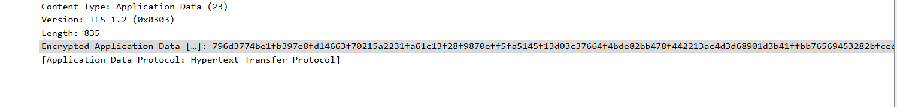
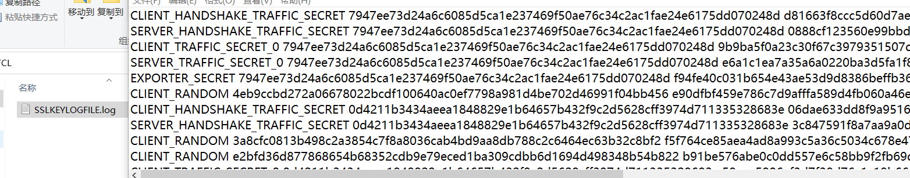
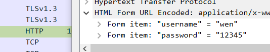

# wireshark抓包
wireshark是一个功能强大的抓包软件
与bp抓包相比它能抓取arp，udp，DNS等多种包

# 功能演示
对于一个网页来说，登录密码一般都是经过加密传输，这里以TLS加密为例

# 找到一个网站
我们随便找到一个网址F12查看网址然后wireshark过滤抓包,结果发现密码和账号是加密的

# 1

# 解密处理
TLS解密需要我们在客户端配置密匙来解密，这边已经配置完成

# 2

# 这边可以看到TLS包被解析成了http包，并且密码和账号都能看到

# 3

